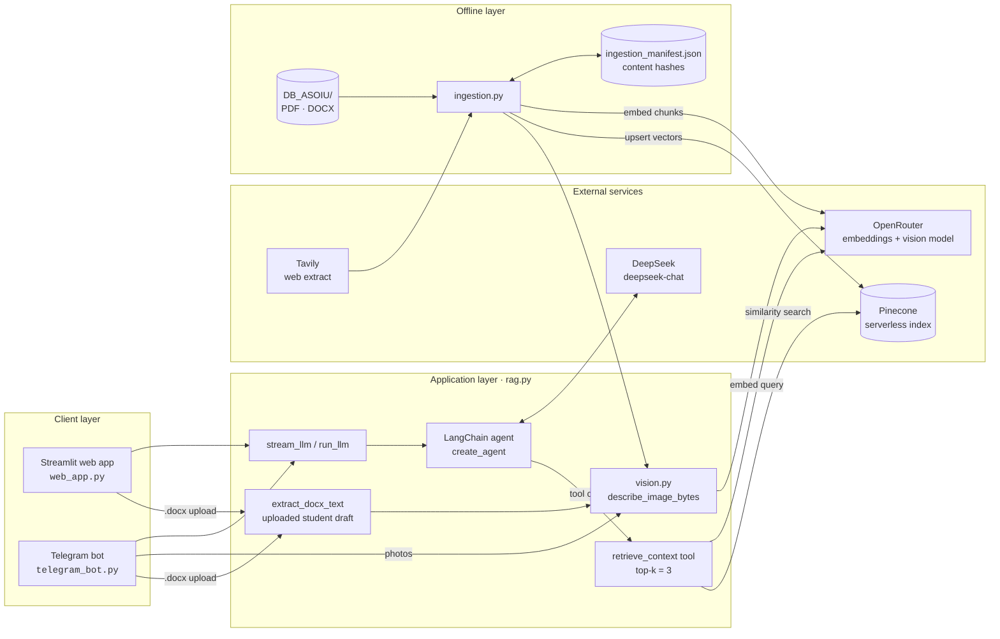
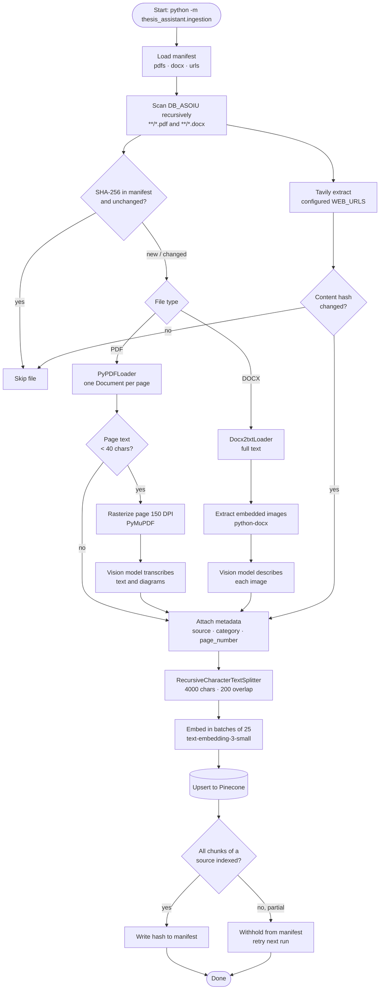
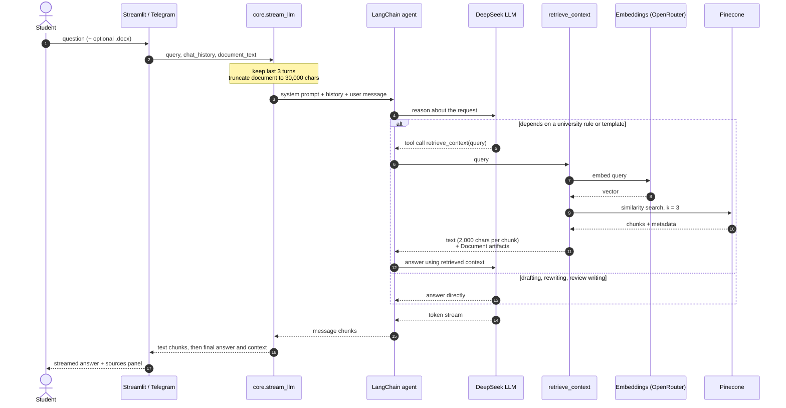
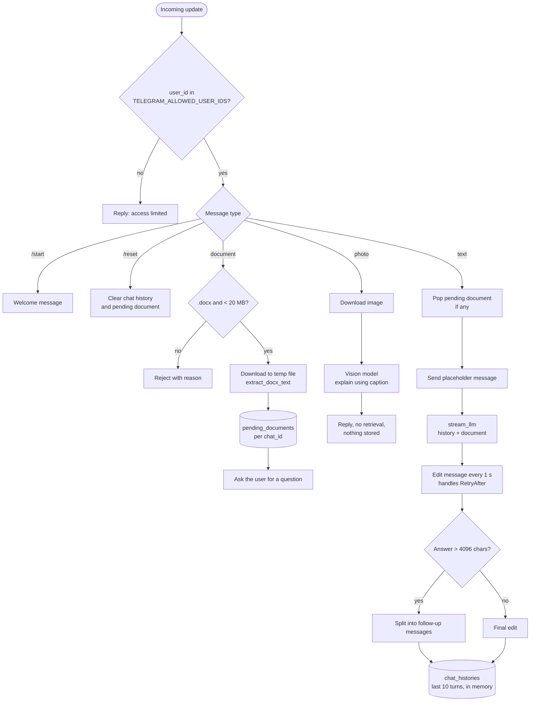
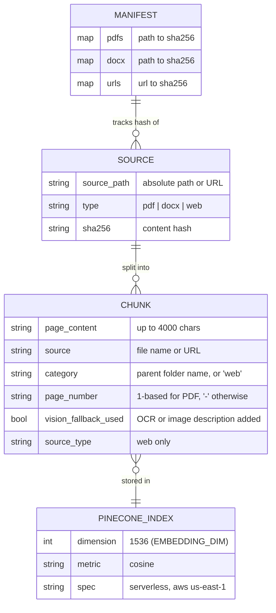

<div align="center">

# RAG Thesis Support Assistant

**Citation-grounded AI assistant for thesis supervision at ASOIU.**<br/>
Rule lookup, drafting support and official review generation, available as a web app and a Telegram bot.


[Quick start](#quick-start) · [Architecture](#3-system-architecture) · [Configuration](#11-configuration-reference) · [Troubleshooting](#15-troubleshooting)

</div>

---

## At a glance

| | |
|---|---|
| **Problem** | Thesis rules, templates and review formats are spread across hundreds of Word and PDF files. |
| **Solution** | Index the corpus in a vector database and serve it through a tool-using LLM agent. |
| **Output** | Answers with `category, page` citations, drafting feedback and ASOIU-format reviews (*rəy*). |
| **Interfaces** | Streamlit web app, Telegram bot (both share one backend). |
| **Corpus** | Bachelor, master, PhD, syllabus and book-writing materials: PDF, DOCX and web pages. |
| **Language** | Azerbaijani-first prompts; English and Russian documents are supported. |

## Quick start

```bash
git clone https://github.com/Elvin-Yusubov/RAG_THESIS_SUPPORT.git
cd RAG_THESIS_SUPPORT && uv sync
cp .env.example .env                 # add your API keys
# place documents under DB_ASOIU/<category>/
uv run python -m thesis_assistant.ingestion      # build the index
uv run streamlit run src/thesis_assistant/web_app.py   # or: uv run python -m thesis_assistant.telegram_bot
```

Full instructions: [Getting started](#10-getting-started).

## Table of contents

1. [Overview](#1-overview)
2. [Key features](#2-key-features)
3. [System architecture](#3-system-architecture)
4. [Ingestion pipeline](#4-ingestion-pipeline)
5. [Query-time RAG flow](#5-query-time-rag-flow)
6. [Telegram bot flow](#6-telegram-bot-flow)
7. [Data model](#7-data-model)
8. [Tech stack](#8-tech-stack)
9. [Project structure](#9-project-structure)
10. [Getting started](#10-getting-started)
11. [Configuration reference](#11-configuration-reference)
12. [Design decisions](#12-design-decisions)
13. [Security](#13-security)
14. [Limitations and roadmap](#14-limitations-and-roadmap)
15. [Troubleshooting](#15-troubleshooting)
16. [Contributing](#16-contributing)

---

## 1. Overview

Students writing a bachelor's, master's or doctoral thesis at **ASOIU** (Azerbaijan State Oil and Industry University) must follow detailed institutional rules for structure, formatting, submission and review. These rules are scattered across many documents and are hard to search.

This project indexes those documents and exposes an AI agent that:

- answers rule and template questions **with citations** to the source document, category and page;
- helps students **draft and improve** their own text;
- writes **formal reviews (rəy)** in the official ASOIU format;
- reads an **uploaded `.docx` draft** and explains photos of diagrams on request.

The agent is instructed never to invent deadlines or formatting rules. If the corpus does not cover a question, it says so and refers the student to their supervisor.

## 2. Key features

| Capability | Description |
|---|---|
| **Cited answers** | Each retrieved chunk carries `source`, `category` and `page_number`, which the agent cites (for example `submission-rules, p.3`). |
| **Agentic retrieval** | Retrieval is a LangChain *tool*. The agent decides when a question depends on an institutional rule and only then searches the index. |
| **Review generation** | Built-in ASOIU review template: header, relevance, three-chapter summary, DAK conformity sentence, score (15 for the supervisor, 5 for an external reviewer) and signature block. |
| **Topic generation** | Thesis-title template for AI-based systems (prediction, diagnostics, control, measurement). |
| **Draft support** | Outlines, rewording and argument feedback, with academic-integrity flags. |
| **Document upload** | A student's `.docx` is read for a single request, including embedded images described by a vision model. It is never added to the shared index. |
| **Vision fallback** | Scanned PDF pages and images inside `.docx` files are transcribed or described so their content becomes searchable. |
| **Incremental ingestion** | SHA-256 manifest: only new or changed files and web pages are re-embedded. Partially failed sources are retried in full. |
| **Streaming** | Token streaming in Streamlit and rate-limit-aware message editing in Telegram. |
| **Hybrid retrieval** | Optional lexical fusion: dense candidates are re-ranked with BM25 using Reciprocal Rank Fusion. Switch with `RETRIEVAL_MODE`. |
| **Retrieval evaluation** | `python -m thesis_assistant.evaluation` reports hit@k, recall@k and MRR and compares dense vs hybrid. |
| **Persistent history** | Telegram conversations are stored in SQLite and survive restarts. |
| **Authentication** | Per-user web accounts with salted PBKDF2 hashes; user-ID allowlist for Telegram. |
| **Rate limiting and usage log** | Sliding-window limit per user; every request is logged (user, channel, latency, sources, success). |
| **Containerised** | `Dockerfile` and `docker-compose.yml` run the web app, bot and ingestion. |

## 3. System architecture



The system has two independent halves that share one contract: **the same embedding model and the same Pinecone index**.

- **Offline:** `ingestion.py` builds and updates the index.
- **Online:** `rag.py` serves both user interfaces through a single agent, so the web app and the Telegram bot behave identically.

## 4. Ingestion pipeline



Key properties:

- **Idempotent.** Re-running costs nothing for unchanged sources.
- **Edit-aware.** Hashing file bytes means an in-place edit triggers re-ingestion even when the file name is the same.
- **Failure-safe.** A source is recorded in the manifest only when every one of its chunks was upserted, so nothing is silently marked as ingested while missing from the index.
- **Category from folder.** The parent folder name becomes the `category` of every chunk.

## 5. Query-time RAG flow



The tool returns **two things**: serialized text for the model and the raw `Document` objects as an artifact. The UI uses the artifacts to render the *Sources* list without parsing model output.

## 6. Telegram bot flow



An uploaded document is attached to the **next text message only**, then discarded. This mirrors the web app and keeps token usage bounded.

## 7. Data model



## 8. Tech stack

| Layer | Technology |
|---|---|
| Orchestration | LangChain (`create_agent`, tools, streaming) |
| Chat model | DeepSeek `deepseek-chat` |
| Embeddings | `openai/text-embedding-3-small` via OpenRouter (1536 dimensions) |
| Vector store | Pinecone serverless, cosine similarity |
| Vision and OCR fallback | `openai/gpt-4o-mini` via OpenRouter |
| Document parsing | PyPDF, PyMuPDF, docx2txt, python-docx |
| Web extraction | Tavily |
| Interfaces | Streamlit, python-telegram-bot |
| Packaging | uv, Python 3.12+ |

## 9. Project structure

```
.
├── src/thesis_assistant/
│   ├── config.py            # all environment-driven settings and limits
│   ├── prompts.py           # system prompt, topic template, ASOIU review template
│   ├── rag.py               # agent, retrieval tool, streaming, docx extraction
│   ├── retrieval.py         # dense / hybrid (BM25 + RRF) retrieval strategies
│   ├── evaluation.py        # recall@k, hit@k, MRR and the evaluation CLI
│   ├── storage.py           # SQLite chat history and usage log
│   ├── answer_eval.py       # citation accuracy and LLM-judged faithfulness
│   ├── logging_config.py    # JSON logging with request IDs
│   ├── metrics.py           # Prometheus metrics
│   ├── ratelimit.py         # sliding-window rate limiter
│   ├── auth.py              # PBKDF2 password hashing and user parsing
│   ├── ingestion.py         # offline pipeline: load, vision fallback, chunk, embed, upsert
│   ├── vision.py            # shared vision/OCR client and image helpers
│   ├── web_app.py           # Streamlit app: auth, upload, streaming chat, sources
│   ├── telegram_bot.py      # Telegram bot: allowlist, docx and photo handling
│   └── console.py           # coloured console logging for ingestion
├── tests/                   # pytest suite (agent, bot, retrieval, storage, auth; no network)
├── evaluation/              # labelled question set for retrieval evaluation
├── Dockerfile, docker-compose.yml
├── SECURITY.md
├── .github/workflows/ci.yml # lint + tests on every push and pull request
├── .streamlit/config.toml   # Streamlit theme
├── .env.example             # environment template
├── pyproject.toml           # dependencies, ruff and pytest config (uv)
└── DB_ASOIU/                # document corpus (git-ignored)
    ├── BOOK_WRITING/
    ├── DB-BACHELOR/
    ├── DB-MASTER/
    ├── DB-PHD/
    └── FENN_PROQRAMI_SYLLABUS/
```

## 10. Getting started

### Prerequisites

- Python 3.12+ and [uv](https://docs.astral.sh/uv/)
- API keys for DeepSeek, OpenRouter, Pinecone and Tavily
- A Telegram bot token from [@BotFather](https://t.me/BotFather) (only for the bot)

### Install

```bash
git clone https://github.com/Elvin-Yusubov/RAG_THESIS_SUPPORT.git
cd RAG_THESIS_SUPPORT
uv sync
cp .env.example .env        # fill in your keys
```

### Add the corpus

Documents are not part of this repository. Place them under `DB_ASOIU/<category>/`. The folder name becomes the citation category.

### Run

```bash
# 1. Build or update the index (safe to re-run)
uv run python -m thesis_assistant.ingestion

# 2a. Web app
uv run streamlit run src/thesis_assistant/web_app.py

# 2b. Telegram bot
uv run python -m thesis_assistant.telegram_bot
```

Bot commands: `/start` shows help and `/reset` clears the conversation. Send text, a `.docx` file, or a photo.

## 11. Configuration reference

All settings are read from `.env`.

| Variable | Default | Purpose |
|---|---|---|
| `DEEPSEEK_API_KEY` | none | Chat model |
| `CHAT_MODEL` / `CHAT_MODEL_PROVIDER` | `deepseek-chat` / `deepseek` | Chat model override |
| `OPENROUTER_API_KEY` | none | Embeddings and vision |
| `PINECONE_API_KEY` | none | Vector database |
| `INDEX_NAME_ASOIU_02` | `rag-asoiu-openai-v2` | Pinecone index name |
| `EMBEDDING_MODEL` | `openai/text-embedding-3-small` | Must be identical at ingestion and query time |
| `EMBEDDING_DIM` | `1536` | Dimension used when creating the index |
| `TAVILY_API_KEY` | none | Web page extraction |
| `ASOIU_DB_ROOT` | `./DB_ASOIU` | Corpus folder |
| `VISION_MODEL` | `openai/gpt-4o-mini` | Vision fallback model |
| `VISION_FALLBACK_ENABLED` | `true` | Toggle OCR and image description |
| `VISION_FALLBACK_MIN_CHARS` | `40` | PDF pages below this length go to vision |
| `VISION_FALLBACK_DPI` | `150` | Rasterization resolution |
| `APP_USERS` | empty | Web accounts as `name:salt$hash;...` (generate with `python -m thesis_assistant.auth`) |
| `APP_PASSWORD` | empty | Legacy shared-password fallback |
| `RETRIEVAL_MODE` / `RETRIEVAL_FETCH_K` | `dense` / `12` | `dense` or `hybrid`; candidates fetched before fusion |
| `RATE_LIMIT_MAX_REQUESTS` / `RATE_LIMIT_WINDOW_SECONDS` | `10` / `60` | Per-user request limit |
| `LOG_FORMAT` / `LOG_LEVEL` | `json` / `INFO` | Log output format and level |
| `METRICS_PORT` | `0` (off) | Port for the Prometheus endpoint (Telegram bot) |
| `STATE_DB_PATH` | `./state/thesis_assistant.db` | SQLite file for chat history and usage log |
| `TELEGRAM_BOT_TOKEN` | none | Bot credentials |
| `TELEGRAM_ALLOWED_USER_IDS` | empty | Comma-separated allowlist (empty means open to everyone) |

<details>
<summary><b>Tunable constants in code</b></summary>

| Constant | Value | File |
|---|---|---|
| Retrieved chunks (k) | 3 | `config.py` |
| Characters per chunk sent to the model | 2,000 | `config.py` |
| History turns in prompt | 3 | `config.py` |
| Uploaded document limit | 30,000 chars | `config.py` |
| Chunk size / overlap | 4,000 / 200 | `config.py` |
| Embedding batch size | 25 | `config.py` |
| Telegram stored turns | 10 | `telegram_bot.py` |

</details>

## 12. Design decisions

- **Retrieval as a tool, not a fixed step.** Drafting and review writing do not need the index, and forcing retrieval on every turn adds latency, cost and noise. The agent searches only when a rule is at stake.
- **One shared core.** Both interfaces call `stream_llm`, so prompts, retrieval and behaviour cannot drift apart.
- **Folder-driven categories.** Adding a new document class means creating a folder. No code change is needed.
- **Hash-based incremental ingestion.** Cheaper and safer than re-embedding everything, and robust to renamed or edited files.
- **Uploads are ephemeral.** Student drafts are private and unreviewed, so they are used as one-shot context and never written to the shared index.
- **Honest refusal over plausible guessing.** An incorrect deadline or formatting rule can cost a student at submission, so the system prompt requires the agent to admit gaps.

## Retrieval evaluation

Retrieval quality should be measured, not assumed. The evaluation CLI scores any retrieval mode on a labelled question set:

```bash
# evaluation/eval_set.jsonl, one JSON object per line:
# {"question": "...", "relevant_sources": ["file-containing-the-answer.pdf"]}
uv run python -m thesis_assistant.evaluation evaluation/eval_set.jsonl --k 3 --compare
```

| Metric | Meaning |
|---|---|
| `hit@k` | Share of questions with at least one relevant source in the top k |
| `recall@k` | Share of all relevant sources found in the top k |
| `mrr` | Mean reciprocal rank of the first relevant result |

`--compare` prints dense and hybrid side by side so the mode can be chosen from data. `evaluation/eval_set.example.jsonl` only shows the format; write the real set against your own indexed corpus (20 to 50 questions is a useful start). Hybrid mode re-orders the dense candidates, so it can improve precision on exact terms (abbreviations, form numbers) but cannot find documents the dense search missed.

## Docker

```bash
cp .env.example .env                       # fill in keys
docker compose run --rm ingest             # build or update the index
docker compose up -d --build               # web on :8501 and the Telegram bot
```

The image runs as an unprivileged user, has a health check, and stores the SQLite state in a named volume. Mount the corpus read-only as shown in `docker-compose.yml`. The Docker files were written but not built in the author's environment, so report any issue you hit.

## Observability and operations

| Concern | Implementation |
|---|---|
| **Structured logs** | One JSON object per line with a per-request `request_id` (`LOG_FORMAT=json`, default; `text` for development). Ready for Loki, CloudWatch or ELK. |
| **Metrics** | Prometheus: `thesis_requests_total{channel,kind,status}`, `thesis_request_latency_seconds`, `thesis_rate_limited_total`, `thesis_sources_per_answer`. The bot serves them on `/metrics` when `METRICS_PORT` is set. |
| **Usage accounting** | Every request is stored in SQLite; `StateStore(...).usage_summary()` returns requests, failures and average latency per user and channel. |
| **LLM tracing** | Set `LANGSMITH_TRACING=true` and `LANGSMITH_API_KEY` to capture agent steps, tool calls, latency and token usage. |
| **Rate limiting** | In-process sliding window per user. Behind several replicas, use a shared store such as Redis. |

Suggested alerts: failure ratio `rate(thesis_requests_total{status="error"}[5m]) / rate(thesis_requests_total[5m]) > 0.05`, and p95 latency above 30 s.

## Answer quality evaluation

Retrieval metrics show whether the right chunks were found. `thesis_assistant.answer_eval` checks whether the answer used them honestly:

- `citation_accuracy(answer, retrieved_sources)` is deterministic and flags cited files that were never retrieved (hallucinated citations).
- `judge_faithfulness(answer, context_chunks, judge)` asks an injected LLM judge whether every claim is supported by the context, and treats unparseable judge output as *not faithful* so failures are never silent.

## 13. Security

See [SECURITY.md](SECURITY.md) for the full policy.

- `.env` is git-ignored. **Rotate any key that was ever committed**, since Git history keeps it.
- Configure `APP_USERS` (per-user accounts, salted PBKDF2) and `TELEGRAM_ALLOWED_USER_IDS` before exposing either interface. With an empty allowlist the bot accepts everyone.
- Both interfaces are rate limited per user.
- Student documents are processed in memory or in temporary files that are deleted after reading, and are never indexed. They are sent to the configured LLM and vision providers, so check your institution's data policy.
- Telegram conversation text is stored in local SQLite until `/reset` (latest 10 exchanges per chat).

## 14. Limitations and roadmap

**Current limitations**

- Answers are only as complete as the indexed corpus.
- Hybrid retrieval re-ranks dense candidates; it is not a full sparse-dense index and cannot recover documents the dense search missed.
- No cross-encoder reranker yet. Faithfulness scoring needs an LLM judge you supply; it is not run automatically.
- Rate limiting and pending-document state are per process; multiple replicas need a shared store such as Redis.
- SQLite suits a single bot instance; use Postgres for horizontal scaling.
- Prompts for reviews and topics are written for Azerbaijani and ASOIU conventions.
- AI-generated reviews are drafts and must be checked by the responsible person.

**Roadmap**

- [x] Retrieval evaluation (hit@k, recall@k, MRR) with dense vs hybrid comparison
- [x] Hybrid (BM25 + dense) retrieval
- [x] Persistent chat history (SQLite)
- [x] Per-user authentication, rate limiting and usage log
- [x] Docker image, compose file and CI workflow
- [ ] Cross-encoder reranking
- [ ] Run the faithfulness judge over the evaluation set automatically
- [x] Citation-accuracy check and pluggable LLM-judge faithfulness metric
- [x] Structured logging, Prometheus metrics, type checking and coverage gate in CI
- [ ] Shared state (Redis) for multi-replica deployment
- [ ] Export of generated reviews to `.docx` in the official template

## 15. Troubleshooting

| Symptom | Likely cause | Fix |
|---|---|---|
| Retrieval returns irrelevant results | Query-time and ingestion-time embedding model differ | Use the same `EMBEDDING_MODEL` in both; re-ingest after changing it |
| Pinecone dimension mismatch error | Existing index has a different dimension | Set `EMBEDDING_DIM` to match the model, or use a new `INDEX_NAME_ASOIU_02` |
| `No PDFs or DOCX files found` | Wrong corpus path | Check `ASOIU_DB_ROOT` or place files in `DB_ASOIU/` |
| A file is never re-ingested | Hash unchanged in manifest | Edit the file, or delete `ingestion_manifest.json` to force a full run |
| Scanned pages produce empty text | Vision fallback disabled or no key | Set `VISION_FALLBACK_ENABLED=true` and `OPENROUTER_API_KEY` |
| Telegram bot answers everyone | Empty allowlist | Set `TELEGRAM_ALLOWED_USER_IDS` |
| Telegram `RetryAfter` warnings | Edit rate limit | Handled automatically; increase `STREAM_EDIT_INTERVAL_SECONDS` if frequent |

## Development

```bash
uv sync --extra dev
uv run ruff check .                  # lint
uv run mypy                          # static type check
uv run pytest --cov                  # tests + coverage (fails under 70%)
pre-commit install                   # optional: run lint and secret checks on every commit
```

No API keys or network are needed. CI runs lint, type check and tests with coverage, then builds the Docker image and smoke-tests the imports, on every push and pull request.

## 16. Contributing

Issues and pull requests are welcome.

1. Fork the repository and create a feature branch.
2. Keep ingestion and query-time settings (embedding model, index) in sync.
3. Never commit `.env`, corpus documents or generated manifests.
4. Describe what you changed and how you verified it in the pull request.

## License

Released under the [MIT License](LICENSE).
